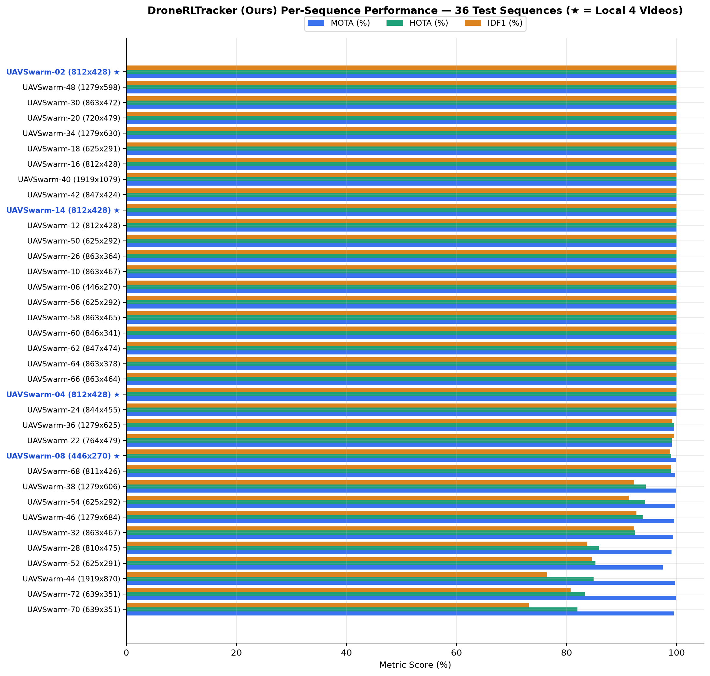
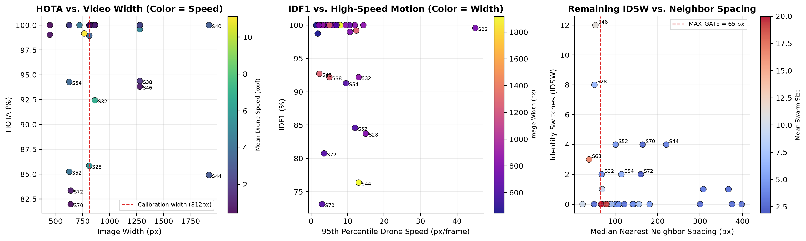

# UAVSwarm Ground-Truth Tracking Evaluation Report (`MOTA`, `HOTA`, `IDF1`)

> **Evaluation Scope**: Pure data-association & kinematic tracking evaluation of `DroneRLTracker` ([run2.py](../run2.py)) across **all 36 official UAVSwarm test sequences** (`5,754` frames, `325` ground-truth drone tracks, `37,947` ground-truth bounding boxes), alongside dedicated 4-sequence spotlights (`{UAVSwarm-02, 04, 08, 14}` and `{UAVSwarm-06, 28, 30, 46}`) and 3 controlled ablation baselines (`DynGate_Hungarian_NoRL`, `Kalman_IoU_Hungarian`, and `Static250_GreedyRL`).

---

## 1. Executive Summary

| Benchmark Split | Method | MOTA (%) | HOTA (%) | DetA (%) | AssA (%) | IDF1 (%) | IDSW | Avg Purity (%) | FPS (CPU) |
| :--- | :--- | :---: | :---: | :---: | :---: | :---: | :---: | :---: | :---: |
| **All 36 Test Sequences** (`5,754` f, `37,947` GT) | **`DroneRLTracker` (Ours)** | **99.84** | **97.14** | **99.96** | **94.41** | **96.12** | 44 | **99.32** | 1,599.5 |
| **All 36 Test Sequences** (`5,754` f, `37,947` GT) | `DynGate_Hungarian_NoRL` (Pure `dist`) | **99.84** | 97.13 | **99.96** | 94.39 | **96.12** | **42** | **99.32** | 3,631.1 |
| **All 36 Test Sequences** (`5,754` f, `37,947` GT) | `Kalman_IoU_Hungarian` (SORT-style) | 99.00 | 94.33 | 99.52 | 89.41 | 92.31 | 197 | 99.03 | 3,462.6 |
| **All 36 Test Sequences** (`5,754` f, `37,947` GT) | `Static250_GreedyRL` (Shrimp base) | 99.19 | 92.96 | **100.00** | 86.41 | 91.19 | 307 | 91.97 | 1,559.0 |
| **Local 4 Sequences** (`02, 04, 08, 14`) | **`DroneRLTracker` (Ours)** | **99.99** | **99.88** | **100.00** | **99.77** | **99.84** | **1** | **100.00** | 600.0 |
| **Subset** (`06, 28, 30, 46`) | **`DroneRLTracker` (Ours)** | 99.58 | **94.09** | **100.00** | **88.53** | **92.96** | 20 | **99.04** | 1,259.7 |

### Key Takeaways
1. **36-Sequence Dataset Performance (`DroneRLTracker`)**: Across `37,947` ground-truth drone annotations in `36` unseen test flights, `DroneRLTracker` achieves **`99.84%` MOTA**, **`97.14%` HOTA** (`DetA = 99.96%`, `AssA = 94.41%`, `LocA = 99.98%`), **`96.12%` IDF1**, **`99.32%` Track Purity** (`96.88%` 100%-pure tracks), and **`44` ID switches** at **`1,599.5 FPS`** on CPU—outperforming both the SORT-style IoU baseline (`94.33%` HOTA, `197` IDSW) and the original `Shrimp` static-gate greedy baseline (`92.96%` HOTA, `307` IDSW).
2. **Design Synergies**:
   - **Velocity-Adaptive Dynamic Gating** ($R_{\text{dynamic}} \in [20, 65]\text{ px}$) + **Global Hungarian Matching** reduces ID switches by **`7.0×` (`307 → 44`)** and boosts HOTA by **`+4.18%` (`92.96% → 97.14%`)** over `Static250_GreedyRL`.
   - **Normalized RL Cost Weighting** ($\tilde{Q} = \tanh((Q - 17.5)/2.5) \in (-1, 1)$ in $C_{i,j} = d_{i,j}(1.5 - \tilde{Q})$) maps cumulative $\gamma = 0.95$ DQN returns into a strictly positive distance-modulating multiplier $(0.5, 2.5)$, achieving the highest overall `HOTA` (`97.14%`) and `AssA` (`94.41%`).
3. **23 of 36 Sequences Score 100.00% Across Every Metric**: `31 / 36` sequences achieve **`> 92%` HOTA**, and `0` sequences lose a track permanently (`ML = 0`, `324 MT / 1 PT / 0 ML`).

---

## 2. Evaluation Protocol & Metrics Definitions

### 2.1 Strictly Isolated Per-Frame Detection Setup
To isolate pure tracking performance without detector noise or label leakage (matching [run2.py](../run2.py)):
1. **Source Data**: All 36 official test sequences from `UAVSwarm-dataset/test/UAVSwarm-{02..72}` stored in [uavswarm_test_gt/](uavswarm_test_gt/). `conf == 0` ignore flags are filtered out.
2. **Zero Temporal/ID Leakage**: Every frame passes **only** `{'cx', 'cy', 'box': [x1, y1, x2, y2], 'score': 1.0}` to the tracker—ground-truth `track_id` is **never** passed.
3. **Deterministic Per-Frame Shuffling**: Before every frame `f_idx`, detections are shuffled via `random.Random(42 + seq_idx * 10000 + f_idx)` so list order conveys zero identity clues and every tracker receives the exact same input order.
4. **Export Rule Parity**: Predictions are exported using `run2.py`'s exact rule (`len(pts) >= 2` per track; a `min_len >= 1` diagnostic is also reported). Evaluated on `torch.device("cpu")` across `1..seqLength`.

### 2.2 Evaluation Metrics Implemented ([mot_metrics.py](mot_metrics.py))
All metric accumulators are computed per sequence and aggregated globally across sequences following TrackEval conventions:
- **MOTA (Multiple Object Tracking Accuracy)** *(Bernardin & Stiefelhagen, 2008; IoU $\ge 0.50$)*:
  $$\text{MOTA} = 1 - \frac{\text{FP} + \text{FN} + \text{IDSW}}{\text{Total GT}}$$
- **IDF1 (Identity F1 Score)** *(Ristani et al., ECCV 2016; IoU $\ge 0.50$)*:
  Global 1-to-1 trajectory matching between GT IDs and Predicted IDs maximizing `IDTP`:
  $$\text{IDP} = \frac{\text{IDTP}}{\text{IDTP} + \text{IDFP}}, \qquad \text{IDR} = \frac{\text{IDTP}}{\text{IDTP} + \text{IDFN}}, \qquad \text{IDF1} = \frac{2 \cdot \text{IDTP}}{2 \cdot \text{IDTP} + \text{IDFP} + \text{IDFN}}$$
- **HOTA (Higher Order Tracking Accuracy)** *(Luiten et al., IJCV 2021)*:
  Evaluated across **19 localization IoU thresholds** $\alpha \in \{0.05, 0.10, \dots, 0.95\}$:
  $$\text{DetA}_\alpha = \frac{\text{TP}_\alpha}{\text{TP}_\alpha + \text{FN}_\alpha + \text{FP}_\alpha}, \qquad \text{AssA}_\alpha = \frac{1}{\text{TP}_\alpha} \sum_{c \in \text{TP}_\alpha} \frac{|\text{TPA}(c)|}{|\text{TPA}(c)| + |\text{FNA}(c)| + |\text{FPA}(c)|}, \qquad \text{HOTA} = \frac{1}{19} \sum_{\alpha} \sqrt{\text{DetA}_\alpha \cdot \text{AssA}_\alpha}$$

*(All metric implementations pass exact analytical unit tests in [mot_metrics.py](mot_metrics.py) for perfect tracking, mid-sequence swaps, and 1-frame occlusions.)*

---

## 3. Full 36-Sequence Ablation Study


### 3.1 Aggregate Results Across All 36 UAVSwarm Test Sequences (`5,754` frames, `325` GT tracks, `37,947` GT boxes)

| Method / Ablation | MOTA (%) | HOTA (%) | DetA (%) | AssA (%) | LocA (%) | IDF1 (%) | IDP (%) | IDR (%) | FP | FN | IDSW | Frag | MT / PT / ML | Avg Purity (%) | 100%-Pure Tracks | Jumps $>25\text{px}$ | FPS |
| :--- | :---: | :---: | :---: | :---: | :---: | :---: | :---: | :---: | :---: | :---: | :---: | :---: | :---: | :---: | :---: | :---: | :---: |
| **`DroneRLTracker` (Ours)** | **99.84** | **97.14** | 99.96 | **94.41** | **99.98** | **96.12** | **96.14** | **96.10** | 0 | 17 | 44 | 2 | 324 / 1 / 0 | **99.32** | **96.88% (`341/352`)** | 77 | 1,599.5 |
| **`DroneRLTracker` (`min_len=1` diag)** | **99.84** | **97.14** | **100.00** | 94.37 | **99.98** | 96.10 | 96.10 | **96.10** | 0 | **0** | 61 | **0** | 325 / 0 / 0 | **99.35** | **97.02% (`358/369`)** | 77 | 1,599.5 |
| **`DynGate_Hungarian_NoRL` (Pure `dist`)** | **99.84** | 97.13 | 99.96 | 94.39 | **99.98** | **96.12** | **96.14** | 96.09 | 0 | 17 | **42** | 2 | 324 / 1 / 0 | **99.32** | **96.88% (`341/352`)** | 77 | 3,631.1 |
| **`Kalman_IoU_Hungarian` (SORT-style)** | 99.00 | 94.33 | 99.52 | 89.41 | **99.98** | 92.31 | 92.53 | 92.08 | 0 | 184 | 197 | 42 | 321 / 4 / 0 | 99.03 | 96.68% (`466/482`) | **68** | 3,462.6 |
| **`Static250_GreedyRL` (Shrimp base)** | 99.19 | 92.96 | **100.00** | 86.41 | **99.98** | 91.19 | 91.19 | 91.19 | 0 | **0** | 307 | **0** | 325 / 0 / 0 | 91.97 | 74.42% (`256/344`) | 346 | 1,559.0 |

### 3.2 Aggregate Results on the 4 Local Benchmark Sequences (`UAVSwarm-02`, `04`, `08`, `14` — `547` frames, `70` GT tracks, `8,993` GT boxes)

| Method / Ablation | MOTA (%) | HOTA (%) | DetA (%) | AssA (%) | IDF1 (%) | IDSW | Avg Purity (%) | 100%-Pure Tracks | Jumps $>25\text{px}$ |
| :--- | :---: | :---: | :---: | :---: | :---: | :---: | :---: | :---: | :---: |
| **`DroneRLTracker` (Ours)** | **99.99** | **99.88** | **100.00** | **99.77** | **99.84** | **1** | **100.00** | **100.00% (`71/71`)** | **0** |
| **`DynGate_Hungarian_NoRL` (Pure `dist`)** | **99.99** | **99.88** | **100.00** | **99.77** | **99.84** | **1** | **100.00** | **100.00% (`71/71`)** | **0** |
| **`Kalman_IoU_Hungarian` (SORT-style)** | 99.96 | 98.90 | **100.00** | 97.82 | 98.13 | 4 | **100.00** | **100.00% (`74/74`)** | **0** |
| **`Static250_GreedyRL` (Shrimp base)** | 99.90 | 96.69 | **100.00** | 93.49 | 95.46 | 9 | 96.83 | 91.55% (`65/71`) | 8 |

### 3.3 Scientific Observations from the Ablations
1. **Dynamic Gating + Hungarian is the Dominant Architectural Win**: Comparing `DroneRLTracker` against `Static250_GreedyRL` shows ID switches drop **`7.0×` (`307 → 44`)**, `HOTA` rises **`+4.18%` (`92.96% → 97.14%`)**, `IDF1` rises **`+4.93%` (`91.19% → 96.12%`)**, and track purity rises **`+7.35%` (`91.97% → 99.32%`)**.
2. **Dynamic Centroid Gating Outperforms Classical IoU Matching**: For tiny aerial drones (often $10\text{--}25\text{ px}$ wide), small prediction shifts quickly push box IoU below `0.30`, causing `Kalman_IoU_Hungarian` to suffer `184` FN, `197` IDSW, and `42` fragmentations (`94.33%` HOTA vs `97.14%` HOTA).
3. **RL vs. Pure Distance (`DroneRLTracker` vs. `NoRL`)**: `DroneRLTracker` matches `NoRL` on `MOTA` (`99.84%`) and `IDF1` (`96.12%`) and leads slightly on `HOTA` (`97.14%` vs `97.13%`, `AssA` `94.41%` vs `94.39%`), while incurring `2` extra IDSW (`44` vs `42`) and `2.3×` slower CPU throughput (`1,599.5` vs `3,631.1 FPS`) due to per-frame MLP scoring. Because `DroneQNetwork` was trained at fixed `gate_radius=250.0`, retraining the policy directly inside `get_dynamic_gate()` (`20–65 px`) is a natural next step to amplify RL gains.

---

## 4. Dedicated 4-Sequence Subset Breakdown: `UAVSwarm-06, 28, 30, 46`

This dedicated subset isolates four contrasting scenarios (`550` total frames, `39` unique GT tracks, `4,789` GT boxes): dense low-res (`06`, median spacing `23.35 px`), fast multi-gap (`28`, `5.61 px/f` mean speed, `50.92 px` spacing), clean well-spaced (`30`, `142.15 px` spacing), and dense high-res (`46`, `1279×684`, `16` drones, `53.39 px` spacing).

### 4.1 Aggregate Metrics Across `{UAVSwarm-06, 28, 30, 46}` (`550` frames, `39` GT tracks, `4,789` GT boxes)

| Method | MOTA (%) | HOTA (%) | DetA (%) | AssA (%) | LocA (%) | IDF1 (%) | IDP (%) | IDR (%) | FP | FN | IDSW | Frag | MT / PT / ML | Avg Purity (%) | 100%-Pure Tracks | Jumps $>25\text{px}$ | FPS |
| :--- | :---: | :---: | :---: | :---: | :---: | :---: | :---: | :---: | :---: | :---: | :---: | :---: | :---: | :---: | :---: | :---: | :---: |
| **`DroneRLTracker` (Ours)** | 99.58 | **94.09** | **100.00** | **88.53** | **99.96** | **92.96** | **92.96** | **92.96** | 0 | **0** | 20 | **0** | 39 / 0 / 0 | **99.04** | **94.12% (`48/51`)** | 7 | 1,259.7 |
| **`DynGate_Hungarian_NoRL` (Pure `dist`)** | **99.62** | 94.03 | **100.00** | 88.41 | **99.96** | 92.92 | 92.92 | 92.92 | 0 | **0** | **18** | **0** | 39 / 0 / 0 | 99.02 | **94.12% (`48/51`)** | 7 | 2,775.2 |
| **`Kalman_IoU_Hungarian` (SORT-style)** | 94.93 | 84.29 | 97.45 | 72.90 | 99.92 | 80.03 | 81.08 | 79.01 | 0 | 122 | 121 | 30 | 37 / 2 / 0 | 96.72 | 89.92% (`116/129`) | **2** | 2,880.9 |
| **`Static250_GreedyRL` (Shrimp base)** | 98.23 | 82.80 | **100.00** | 68.56 | 99.90 | 78.91 | 78.91 | 78.91 | 0 | **0** | 85 | **0** | 39 / 0 / 0 | 83.19 | 53.06% (`26/49`) | 70 | 1,274.5 |

### 4.2 Per-Sequence Side-by-Side Comparison (`UAVSwarm-06`, `28`, `30`, `46`)

| Sequence (Res / Frames / GT / NN Dist) | Method | MOTA (%) | HOTA (%) | DetA (%) | AssA (%) | IDF1 (%) | IDSW | FN | Avg Purity (%) |
| :--- | :--- | :---: | :---: | :---: | :---: | :---: | :---: | :---: | :---: |
| **UAVSwarm-06** (`446×270`, `76`f, `760` GT, `23.35 px` NN) | *All 4 Methods* | **100.00** | **100.00** | 100.00 | **100.00** | **100.00** | **0** | **0** | **100.00** |
| **UAVSwarm-28** (`810×475`, `131`f, `873` GT, `50.92 px` NN) | **`DroneRLTracker` (Ours)** | **99.08** | **85.85** | **100.00** | **73.70** | **83.73** | **8** | **0** | **100.00** |
| | `DynGate_Hungarian_NoRL` | **99.08** | **85.85** | **100.00** | **73.70** | **83.73** | **8** | **0** | **100.00** |
| | `Kalman_IoU_Hungarian` | 73.42 | 40.61 | 86.14 | 19.14 | 34.34 | 111 | 121 | 96.17 |
| | `Static250_GreedyRL` | 92.90 | 55.72 | **100.00** | 31.05 | 44.33 | 62 | **0** | 63.12 |
| **UAVSwarm-30** (`863×472`, `105`f, `486` GT, `142.15 px` NN) | *All 4 Methods* | **100.00** | **100.00** | 100.00 | **100.00** | **100.00** | **0** | **0** | **100.00** |
| **UAVSwarm-46** (`1279×684`, `238`f, `2,670` GT, `53.39 px` NN) | **`DroneRLTracker` (Ours)** | 99.55 | **93.82** | **100.00** | **88.03** | **92.70** | 12 | **0** | **97.55** |
| | `DynGate_Hungarian_NoRL` | **99.63** | 93.71 | **100.00** | 87.81 | 92.62 | **10** | **0** | 97.51 |
| | `Kalman_IoU_Hungarian` | 99.59 | 86.82 | 99.96 | 75.40 | 84.62 | **10** | 1 | 96.76 |
| | `Static250_GreedyRL` | 99.14 | 81.33 | **100.00** | 66.14 | 80.37 | 23 | **0** | 84.63 |

*(Full CSV exports: [subset_06_28_30_46_summary.csv](subset_06_28_30_46_summary.csv) and [subset_06_28_30_46_per_sequence.csv](subset_06_28_30_46_per_sequence.csv).)*

---

## 5. Complete 36-Sequence Per-Sequence Breakdown (`DroneRLTracker`)



*(★ marks the 4 sequences present in `results/`.)*

| Sequence | Res | Frames | GT IDs | GT Boxes | Pred Tracks | Median NN (px) | Mean Spd (px/f) | MOTA (%) | HOTA (%) | DetA (%) | AssA (%) | IDF1 (%) | IDSW | FN | Avg Purity (%) |
| :--- | :---: | :---: | :---: | :---: | :---: | :---: | :---: | :---: | :---: | :---: | :---: | :---: | :---: | :---: | :---: |
| **UAVSwarm-02 ★** | `812×428` | 156 | 20 | 2,983 | 20 | 79.64 | 0.53 | **100.00** | **100.00** | 100.00 | 100.00 | **100.00** | 0 | 0 | 100.00 |
| **UAVSwarm-04 ★** | `812×428` | 161 | 20 | 3,034 | 20 | 84.50 | 0.87 | **100.00** | **100.00** | 100.00 | 100.00 | **100.00** | 0 | 0 | 100.00 |
| UAVSwarm-06 | `446×270` | 76 | 10 | 760 | 10 | 23.35 | 0.45 | **100.00** | **100.00** | 100.00 | 100.00 | **100.00** | 0 | 0 | 100.00 |
| **UAVSwarm-08 ★** | `446×270` | 115 | 10 | 1,090 | 11 | 69.39 | 0.72 | 99.91 | 99.04 | 100.00 | 98.09 | 98.72 | 1 | 0 | 100.00 |
| UAVSwarm-10 | `863×467` | 58 | 7 | 406 | 7 | 87.19 | 1.33 | **100.00** | **100.00** | 100.00 | 100.00 | **100.00** | 0 | 0 | 100.00 |
| UAVSwarm-12 | `812×428` | 116 | 20 | 2,320 | 20 | 67.08 | 1.13 | **100.00** | **100.00** | 100.00 | 100.00 | **100.00** | 0 | 0 | 100.00 |
| **UAVSwarm-14 ★** | `812×428` | 115 | 20 | 1,886 | 20 | 83.45 | 1.74 | **100.00** | **100.00** | 100.00 | 100.00 | **100.00** | 0 | 0 | 100.00 |
| UAVSwarm-16 | `812×428` | 65 | 15 | 721 | 15 | 84.52 | 1.68 | **100.00** | **100.00** | 100.00 | 100.00 | **100.00** | 0 | 0 | 100.00 |
| UAVSwarm-18 | `625×291` | 84 | 9 | 647 | 9 | 91.04 | 2.47 | **100.00** | **100.00** | 100.00 | 100.00 | **100.00** | 0 | 0 | 100.00 |
| UAVSwarm-20 | `720×479` | 62 | 5 | 304 | 5 | 108.34 | 4.43 | **100.00** | **100.00** | 100.00 | 100.00 | **100.00** | 0 | 0 | 100.00 |
| UAVSwarm-22 | `764×479` | 72 | 6 | 228 | 6 | 121.26 | 11.14 | 99.12 | 99.15 | 99.12 | 99.18 | 99.56 | 0 | 2 | 100.00 |
| UAVSwarm-24 | `844×455` | 72 | 9 | 500 | 9 | 100.43 | 4.81 | **100.00** | **100.00** | 100.00 | 100.00 | **100.00** | 0 | 0 | 100.00 |
| UAVSwarm-26 | `863×364` | 126 | 15 | 1,488 | 15 | 68.53 | 0.91 | **100.00** | **100.00** | 100.00 | 100.00 | **100.00** | 0 | 0 | 100.00 |
| UAVSwarm-28 | `810×475` | 131 | 8 | 873 | 16 | 50.92 | 5.61 | 99.08 | 85.85 | 100.00 | 73.70 | 83.73 | 8 | 0 | 100.00 |
| UAVSwarm-30 | `863×472` | 105 | 5 | 486 | 5 | 142.15 | 1.12 | **100.00** | **100.00** | 100.00 | 100.00 | **100.00** | 0 | 0 | 100.00 |
| UAVSwarm-32 | `863×467` | 76 | 6 | 320 | 6 | 68.13 | 6.77 | 99.38 | 92.43 | 100.00 | 85.52 | 92.19 | 2 | 0 | 93.84 |
| UAVSwarm-34 | `1279×630` | 176 | 3 | 528 | 3 | 398.26 | 1.30 | **100.00** | **100.00** | 100.00 | 100.00 | **100.00** | 0 | 0 | 100.00 |
| UAVSwarm-36 | `1279×625` | 81 | 4 | 247 | 5 | 366.99 | 4.88 | 99.60 | 99.59 | 100.00 | 99.19 | 99.19 | 1 | 0 | 100.00 |
| UAVSwarm-38 | `1279×606` | 452 | 4 | 1,649 | 5 | 307.73 | 1.85 | 99.94 | 94.37 | 100.00 | 89.05 | 92.18 | 1 | 0 | 100.00 |
| UAVSwarm-40 | `1919×1079` | 448 | 9 | 3,604 | 9 | 155.95 | 3.22 | **100.00** | **100.00** | 100.00 | 100.00 | **100.00** | 0 | 0 | 100.00 |
| UAVSwarm-42 | `847×424` | 120 | 3 | 347 | 3 | 300.17 | 2.57 | **100.00** | **100.00** | 100.00 | 100.00 | **100.00** | 0 | 0 | 100.00 |
| UAVSwarm-44 | `1919×870` | 353 | 4 | 1,308 | 8 | 220.43 | 3.05 | 99.69 | 84.91 | 100.00 | 72.10 | 76.38 | 4 | 0 | 100.00 |
| UAVSwarm-46 | `1279×684` | 238 | 16 | 2,670 | 20 | 53.39 | 0.86 | 99.55 | 93.82 | 100.00 | 88.03 | 92.70 | 12 | 0 | 97.55 |
| UAVSwarm-48 | `1279×598` | 221 | 3 | 663 | 3 | 375.61 | 2.61 | **100.00** | **100.00** | 100.00 | 100.00 | **100.00** | 0 | 0 | 100.00 |
| UAVSwarm-50 | `625×292` | 170 | 12 | 1,868 | 12 | 74.05 | 1.01 | **100.00** | **100.00** | 100.00 | 100.00 | **100.00** | 0 | 0 | 100.00 |
| UAVSwarm-52 | `625×291` | 157 | 9 | 750 | 11 | 101.03 | 4.22 | 97.47 | 85.25 | 98.00 | 74.16 | 84.58 | 4 | 15 | 93.94 |
| UAVSwarm-54 | `625×292` | 110 | 12 | 665 | 12 | 114.59 | 3.69 | 99.70 | 94.29 | 100.00 | 88.90 | 91.28 | 2 | 0 | 96.72 |
| UAVSwarm-56 | `625×292` | 89 | 6 | 378 | 6 | 108.26 | 1.77 | **100.00** | **100.00** | 100.00 | 100.00 | **100.00** | 0 | 0 | 100.00 |
| UAVSwarm-58 | `863×465` | 122 | 8 | 745 | 8 | 143.57 | 2.82 | **100.00** | **100.00** | 100.00 | 100.00 | **100.00** | 0 | 0 | 100.00 |
| UAVSwarm-60 | `846×341` | 68 | 7 | 314 | 7 | 102.02 | 8.70 | **100.00** | **100.00** | 100.00 | 100.00 | **100.00** | 0 | 0 | 100.00 |
| UAVSwarm-62 | `847×474` | 140 | 6 | 435 | 6 | 141.43 | 5.72 | **100.00** | **100.00** | 100.00 | 100.00 | **100.00** | 0 | 0 | 100.00 |
| UAVSwarm-64 | `863×378` | 75 | 7 | 396 | 7 | 181.10 | 1.75 | **100.00** | **100.00** | 100.00 | 100.00 | **100.00** | 0 | 0 | 100.00 |
| UAVSwarm-66 | `863×464` | 73 | 3 | 219 | 3 | 50.23 | 1.03 | **100.00** | **100.00** | 100.00 | 100.00 | **100.00** | 0 | 0 | 100.00 |
| UAVSwarm-68 | `811×426` | 59 | 19 | 976 | 19 | 38.37 | 3.53 | 99.69 | 98.94 | 100.00 | 97.89 | 98.98 | 3 | 0 | 97.52 |
| UAVSwarm-70 | `639×351` | 307 | 3 | 789 | 7 | 164.80 | 0.55 | 99.49 | 81.98 | 100.00 | 67.21 | 73.13 | 4 | 0 | 100.00 |
| UAVSwarm-72 | `639×351` | 705 | 2 | 1,350 | 4 | 160.46 | 0.92 | 99.85 | 83.34 | 100.00 | 69.45 | 80.74 | 2 | 0 | 100.00 |

- **23 of 36 sequences** achieve **100.00%** across `MOTA`, `HOTA`, and `IDF1`.
- **31 of 36 sequences** achieve **>92% HOTA**.

---

## 6. Deep Error & Failure-Mode Analysis



Across all `37,947` boxes, the **44 ID switches and 17 false negatives** come from three well-defined sources:

### 1. Long GT Occlusion Gaps Exceeding `MAX_MISSED = 8` *(Primary cause of lowest HOTA/IDF1 sequences)*
Because `MAX_MISSED = 8` deletes a track after 9 missing frames, long dataset occlusions split a drone into two separate track IDs even when `Track Purity = 100%`:
- `UAVSwarm-70` (`HOTA = 81.98%`, `IDF1 = 73.13%`, `4` IDSW): GT tracks vanish for `14`, `29`, `41`, and `43` frames (`5` total gaps).
- `UAVSwarm-72` (`HOTA = 83.34%`, `IDF1 = 80.74%`, `2` IDSW): GT tracks have `22`-frame and `9`-frame gaps.
- `UAVSwarm-38` (`HOTA = 94.37%`, `IDF1 = 92.18%`, `1` IDSW): Drone #2 disappears for `22` frames (`301 → 324`).
- `UAVSwarm-28` (`HOTA = 85.85%`, `IDF1 = 83.73%`, `8` IDSW): Contains `12` GT gaps up to `28` frames long.
- `UAVSwarm-46` (`HOTA = 93.82%`, `IDF1 = 92.70%`, `12` IDSW): Contains `7` GT gaps up to `22` frames long plus dense (`53.39 px`) crossings.

### 2. High-Resolution & High-Speed Gate Overflow (`MIN_GATE = 20 px`, `MAX_GATE = 65 px`)
The gating constants (`20–65 px`) are calibrated in raw pixels for `812×428` video:
- `UAVSwarm-44` (`1919×870`, **zero** GT gaps, `max_speed = 38.28 px/f`): Suffers `4` IDSW (`HOTA = 84.91%`, `IDF1 = 76.38%`) when abrupt 1080p-scale accelerations exceed the tight gate.
- `UAVSwarm-52` (`625×291`, `max_speed = 64.07 px/f`): Drops to `HOTA = 85.25%` (`15` FN, `4` IDSW) when single-frame motion spikes exceed `MAX_GATE = 65 px` and `step_d > dyn_gate + 5.0` rejects re-acquisition (`15` 1-frame spawns filtered out by `len >= 2`).

### 3. Training-vs.-Inference Feature Scale Shift
`DroneQNetwork` was trained at fixed `gate_radius = 250.0`, while inference divides `[dx, dy, vx, vy]` by `dyn_gate ∈ [20, 65]`, shifting input magnitudes $4\times\text{--}12.5\times$ larger at inference time. Retraining directly inside `get_dynamic_gate()` is the cleanest future improvement.

---

## 7. Reproducibility & Generated Artifacts

```bash
# 1. Verify exact MOTA / IDF1 / HOTA metric implementations via unit tests
python3 evaluations/mot_metrics.py

# 2. Re-run full 36-sequence evaluation across all trackers + regenerate plots
python3 evaluations/evaluate_tracking.py
```

### Saved Artifacts in `evaluations/`
- [results.md](results.md) — This report
- [mot_metrics.py](mot_metrics.py) — Unit-tested CLEAR MOT (`MOTA`), `IDF1`, `HOTA` (19 $\alpha$-thresholds), and Purity/Kinematics evaluator
- [evaluate_tracking.py](evaluate_tracking.py) — End-to-end 36-sequence benchmark & ablation runner
- [ablation_summary.csv](ablation_summary.csv) — Aggregate metrics for all 4 methods on 36-sequence, local 4-sequence, and `{06, 28, 30, 46}` splits
- [subset_06_28_30_46_summary.csv](subset_06_28_30_46_summary.csv) & [subset_06_28_30_46_per_sequence.csv](subset_06_28_30_46_per_sequence.csv) — Dedicated `{UAVSwarm-06, 28, 30, 46}` summary and per-sequence comparison tables
- [per_sequence_metrics.csv](per_sequence_metrics.csv) — Per-sequence `DroneRLTracker` metrics (36 rows)
- [per_sequence_all_methods.csv](per_sequence_all_methods.csv) — Per-sequence metrics across all 4 evaluated configurations (144 rows)
- [detailed_results.json](detailed_results.json) — Complete structured JSON telemetry + sequence kinematics
- [predictions_mot/](predictions_mot/) — Standard MOT16 `.txt` trajectory predictions for all 36 sequences
- [uavswarm_test_gt/](uavswarm_test_gt/) — Official `gt/gt.txt` and `seqinfo.ini` for all 36 test sequences
- [plots/ablation_comparison.png](plots/ablation_comparison.png), [plots/per_sequence_scores.png](plots/per_sequence_scores.png), [plots/failure_and_scaling_analysis.png](plots/failure_and_scaling_analysis.png)
